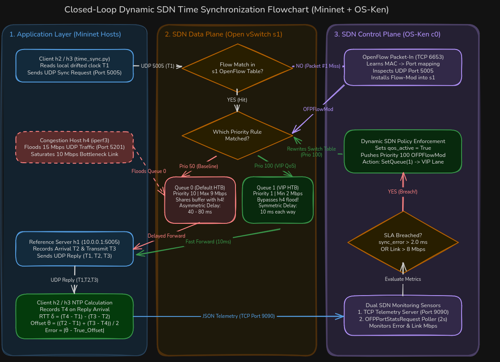

# SDN-Assisted Dynamic UDP Time Synchronization in Mininet (with OS-Ken)

## 1. Project Overview & Problem Statement

This project implements a Network Time Protocol (NTP)-style clock synchronization system using **UDP sockets**, deployed inside a **Mininet** virtual network and dynamically managed by an **OS-Ken** Software-Defined Networking (SDN) controller via **OpenFlow 1.3**.

### The Core Problem: Why Congestion Breaks UDP Time Synchronization
UDP clock synchronization calculates a client's clock offset ($\theta$) by assuming that the one-way network delay from **Client to Server** ($d_{\text{forward}}$) equals the delay from **Server to Client** ($d_{\text{reverse}}$). 

When background network congestion floods a switch port, packets sit in switch buffers unevenly (**asymmetric queuing delay and jitter**). Because the forward path and return path no longer take the same amount of time, the NTP offset equation produces massive **synchronization errors** ($15\text{ ms} - 60\text{ ms+}$).

### Our Solution: Closed-Loop Dynamic SDN Traffic Prioritization
Instead of relying on static network rules, our system implements a **Closed-Loop Reactive SDN Architecture**:
1. **UDP Time Sync Plane (`Port 5005`):** Multiple clients (`h2`, `h3`) exchange 4-timestamp UDP probes with a reference server (`h1`), estimate their clock offset, apply adaptive clock correction, and calculate real-time synchronization error.
2. **TCP Telemetry & Control Plane (`Port 9090`):** Clients stream real-time JSON telemetry (`rtt_ms`, `sync_error_ms`) over TCP to the SDN controller. Simultaneously, the SDN controller polls Open vSwitch port byte counters every 2 seconds via OpenFlow (`OFPPortStatsRequest`).
3. **Dynamic QoS Enforcement (`OpenFlow 1.3` + `linux-htb`):** The network starts in **Baseline Mode** (all traffic shares default `Queue 0`). The instant a client reports an SLA violation (`sync_error_ms > 2.0 ms`) or link throughput exceeds `8.0 Mbps`, the OS-Ken controller dynamically rewrites the switch flow tables (`OFPFlowMod`, `Priority 100`, `OFPActionSetQueue(1)`), elevating UDP `5005` packets into a dedicated high-priority hardware/kernel queue (`Queue 1`) and restoring sub-millisecond synchronization accuracy mid-flight.

---

## 2. System Architecture & Network Topology


### Node & Component Specifications

| Component | Node / IP | Protocol & Port | Role & Responsibility |
| :--- | :--- | :--- | :--- |
| **SDN Controller** | `c0` (`127.0.0.1`) | OpenFlow (`TCP 6653`) | Runs `sdn_controller.py`. Manages L2 learning, polls `OFPPortStatsRequest`, listens for TCP telemetry, and dynamically enforces QoS queues. |
| **Telemetry Bridge** | `s1` (`10.0.0.254`) | `TCP 9090` | Root namespace internal OVS interface allowing virtual hosts (`h2`, `h3`) to send JSON monitoring reports to the controller. |
| **Reference Server** | `h1` (`10.0.0.1`) | `UDP 5005` / `UDP 5201` | Primary stratum reference clock (`time_sync.py --role server`) and `iperf3 -s` background traffic sink. |
| **Time Client 1** | `h2` (`10.0.0.2`) | `UDP` (ephemeral) | Primary test client simulated with a `+2.5s` local clock offset; streams live telemetry to `10.0.0.254:9090`. |
| **Time Client 2** | `h3` (`10.0.0.3`) | `UDP` (ephemeral) | Secondary concurrent client simulated with a `-1.2s` local clock offset to verify multi-client scalability. |
| **Congestion Host** | `h4` (`10.0.0.4`) | `UDP 5201` | Floods `15 Mbps` of UDP traffic toward `h1` to saturate the `10 Mbps` bottleneck link (`s1-eth1`). |

### Protocol Responsibilities Matrix

| Protocol | OSI Layer | Usage in Project | Why This Protocol Was Chosen |
| :--- | :--- | :--- | :--- |
| **UDP** | Transport (L4) | 4-Timestamp synchronization (`Port 5005`) & `iperf3` congestion generation (`Port 5201`). | Zero connection-setup overhead and no TCP retransmission delays, which is critical for accurate hardware/kernel timestamping. |
| **TCP** | Transport (L4) | OpenFlow control channel (`Port 6653`) & Client-to-SDN Telemetry (`Port 9090`). | Reliable, connection-oriented delivery guarantees that SLA violation alerts, mode switches, and `OFPFlowMod` rules are never lost. |
| **ICMP (Ping)** | Network (L3) | Reachability diagnostics (`pingall`, `ping`) and ARP cache warm-up. | Network-layer control protocol used to verify baseline L2/L3 forwarding rules before application testing. |

---

## 3. Core Concepts Explained Simply

1. **Mininet (The Network Emulator):**
   Mininet emulates a complete network of hosts, links, and switches on a single Linux machine. Instead of booting heavy Virtual Machines, it uses lightweight **Linux Network Namespaces (`netns`)** (isolated network stacks sharing one kernel), **Virtual Ethernet (`veth`) pairs** (virtual cables), and **Linux Traffic Control (`tc`)** to enforce exact link bandwidths (`10 Mbps`) and propagation delays (`10 ms`).
2. **Open vSwitch / `s1` (The Data Plane Muscle):**
   Open vSwitch (OVS) is a production-grade virtual multilayer switch running in the Linux kernel. It holds a **Flow Table** (a fast lookup table matching packet headers to actions) and hardware/kernel **QoS Queues** (`Queue 0` for normal traffic, `Queue 1` for high-priority time sync). If a packet matches a rule in the Flow Table, `s1` forwards it in microseconds; if not, `s1` asks the SDN Controller.
3. **OpenFlow 1.3 (The Communication Protocol):**
   OpenFlow is the standardized protocol (`TCP port 6653`) that separates the network's **Control Plane** (brain) from its **Data Plane** (muscle). Key messages used in this project:
   * `OFPPacketIn`: Switch asks the controller what to do with an unrecognized packet.
   * `OFPFlowMod`: Controller installs, modifies, or deletes forwarding and queue-assignment rules inside the switch.
   * `OFPPortStatsRequest` / `Reply`: Controller queries the switch for real-time transmitted byte/packet counters per port.
4. **OS-Ken (The SDN Control Plane Brain):**
   OS-Ken is OpenStack's actively maintained Python SDN framework (the modern fork of **Ryu**). Our `sdn_controller.py` runs inside `osken-manager`, parsing packet headers (`ethernet`, `ipv4`, `udp`) and executing event-driven policies (`@set_ev_cls`).

---

## 4. Mathematical Model & Proof of Congestion Error

### 4.1 The 4-Timestamp Exchange
Because all Mininet namespaces share the host Linux kernel clock (`time.time()`), each client simulates an independent drifted clock by adding an artificial offset ($\Delta_{\text{artificial}}$):

$$\text{LocalClientClock}(t) = t + \Delta_{\text{artificial}}$$

During each synchronization probe, four IEEE 754 double-precision timestamps (`!ddd`, 24 bytes) are recorded:
1. **$T_1$:** Client transmits UDP request (stamped using Client's drifted clock).
2. **$T_2$:** Server receives UDP request (stamped using Server's reference clock).
3. **$T_3$:** Server transmits UDP reply containing $(T_1, T_2, T_3)$ (stamped using Server's reference clock).
4. **$T_4$:** Client receives UDP reply (stamped using Client's drifted clock).

### 4.2 Delay, Offset, and Error Equations
From $(T_1, T_2, T_3, T_4)$, the client calculates:

* **Round-Trip Delay ($\delta$):**
  $$\delta = (T_4 - T_1) - (T_3 - T_2)$$

* **Estimated Clock Offset ($\theta$):**
  $$\theta = \frac{(T_2 - T_1) + (T_3 - T_4)}{2}$$

* **True Offset ($\theta_{\text{true}}$):**
  The exact correction needed to align the client's local clock back to the reference clock:
  $$\theta_{\text{true}} = -\Delta_{\text{artificial}}$$

* **Synchronization Error ($E_{\text{sync}}$):**
  $$E_{\text{sync}} = |\theta - \theta_{\text{true}}|$$

* **Adaptive Clock Correction (Residual Drift):**
  After estimating $\theta$, the client applies the correction $\text{CorrectedClock} = \text{LocalClientClock}(t) + \theta$ and measures residual drift against true reference time.

### 4.3 Why Asymmetric Congestion Corrupts $\theta$
Let $d_{\text{forward}}$ be the true one-way network delay from Client $\rightarrow$ Server, and $d_{\text{reverse}}$ be the one-way delay from Server $\rightarrow$ Client. Since $T_2 = T_1 + \theta_{\text{true}} + d_{\text{forward}}$ and $T_4 = T_3 - \theta_{\text{true}} + d_{\text{reverse}}$, substituting into the offset equation yields:

$$\theta = \theta_{\text{true}} + \frac{d_{\text{forward}} - d_{\text{reverse}}}{2}$$

$$\implies E_{\text{sync}} = \left| \frac{d_{\text{forward}} - d_{\text{reverse}}}{2} \right|$$

* **Under Normal Conditions (or SDN QoS Queue 1):** $d_{\text{forward}} \approx 10\text{ ms}$ and $d_{\text{reverse}} \approx 10\text{ ms}$. Because $10 - 10 = 0$, the network delays cancel out completely and $E_{\text{sync}} \approx 0\text{ ms}$!
* **Under Unmanaged Congestion (`Queue 0`):** `h4` floods `15 Mbps` toward `h1` across the `10 Mbps` bottleneck (`s1-eth1`). The forward path ($T_1 \to T_2$) shares `s1-eth1` with the flood and suffers $+70\text{ ms}$ of queuing delay ($d_{\text{forward}} = 80\text{ ms}$), whereas the return path ($T_3 \to T_4$) exits `s1-eth2` with zero congestion ($d_{\text{reverse}} = 10\text{ ms}$). This asymmetry induces a massive error of $\frac{|80 - 10|}{2} = 35\text{ ms}$!

---

## 5. Complete Environment Setup (CachyOS / Arch Linux & Ubuntu with `uv`)

### Step 5.1: Install System Packages & Start Open vSwitch
Mininet and Open vSwitch interact directly with the Linux kernel (`netns`, `ovs-vsctl`, `tc`) and must be installed globally.

**On CachyOS / Arch Linux:**
```bash
sudo pacman -Syu mininet openvswitch iproute2 iperf3 psmisc
```

**On Ubuntu / Debian:**
```bash
sudo apt update && sudo apt install -y mininet openvswitch-switch iproute2 iperf3 psmisc
```

**Enable and Start the Open vSwitch Kernel Module & Daemons:**
```bash
sudo modprobe openvswitch
sudo systemctl enable --now ovsdb-server.service
sudo systemctl enable --now ovs-vswitchd.service
```
> **Why this is required:** On Arch/CachyOS, `pacman` does not auto-start systemd services. If `ovsdb-server` and `ovs-vswitchd` are not running, Mininet will hang indefinitely at `*** Starting 1 switches s1`.

### Step 5.2: Initialize the Python Environment with `uv`
```bash
# 1. Create and enter project directory
mkdir -p sdn-time-sync && cd sdn-time-sync

# 2. Initialize uv with Python 3.11
uv init --python 3.11

# 3. Add OS-Ken (<4.0.0), Eventlet, Setuptools, and Matplotlib
uv add "os-ken<4.0.0" "eventlet<0.37.0" "setuptools<80" matplotlib
```
> **Why `os-ken<4.0.0`?** In `os-ken` v4.0.0+, OpenStack removed the standalone `osken-manager` CLI binary. Pinning `<4.0.0` ensures `uv run osken-manager` is installed inside `.venv/bin/`.

```bash
# 4. Link system Mininet Python bindings into the isolated uv virtual environment
python3 -c "import mininet, os; print(os.path.dirname(os.path.dirname(mininet.__file__)))" \
  > $(uv run python -c "import site; print(site.getsitepackages()[0])")/system_mininet.pth
```
> **What this command does:** Queries the global Python installation for the path to `mininet` and writes a `.pth` pointer file inside `.venv` so `uv` and your IDE can import `mininet` seamlessly.

**Verify the Environment:**
```bash
uv run python -c "import mininet.net; print('Mininet import: OK')"
uv run osken-manager --version
```

---

## 6. Project Source Code Structure

Ensure the following 5 files are present in your project directory:

```text
sdn-time-sync/
├── README.md            # Complete project documentation, setup, and viva guide
├── pyproject.toml       # uv package configuration
├── time_sync.py         # UDP Time Server & Multi-Client with TCP Telemetry & CSV logging
├── sdn_controller.py    # Dynamic OS-Ken OpenFlow 1.3 Controller (Telemetry + PortStats + QoS)
├── topology.py          # Mininet Star Topology, OVS HTB Queue builder, and Auto-Evaluator
└── evaluate.py          # Matplotlib performance plotter & statistical table generator
```

---

## 7. How to Run the Project (Automated & Manual Modes)

Always keep **two terminal windows** open in your project root directory.

### Mode A: One-Command Automated Deliverable 2 Evaluation (Recommended)
This mode automatically runs all 3 comparative SDN regimes (**Static Baseline No-QoS**, **Dynamic Reactive SDN**, and **Proactive SDN QoS**) under a `15 Mbps` congestion flood, verifies multi-client concurrency (`h2` + `h3`), exports CSV logs, and generates comparison plots.

**1. Terminal 1 — Start the OS-Ken SDN Controller:**
```bash
uv run osken-manager sdn_controller.py
```
* **Expected Output in Terminal 1:**
  ```text
  loading app sdn_controller.py
  instantiating app sdn_controller.py of DynamicTimeSyncSDN
  [TCP Monitor] Listening for Telemetry on TCP port 9090...
  ```

**2. Terminal 2 — Run the Automated Mininet Benchmark Suite:**
```bash
sudo mn -c && sudo .venv/bin/python topology.py --auto-eval
```
* **What happens during execution:**
  * **Regime 1 (`results_baseline_no_qos.csv`):** Controller locks `qos_active=False`. When `h4` injects the `15 Mbps` UDP flood at $t = 3.0\text{ s}$, RTT jumps from `20.3 ms` to `80–140 ms` and `sync_error_ms` spikes to `25–55 ms`.
  * **Regime 2 (`results_dynamic_sdn.csv`):** Controller starts in `Queue 0`. As soon as `h4` starts flooding, `h2` experiences one high-error packet (`> 2.0 ms`) and reports it via TCP `9090`. Terminal 1 immediately logs:
    `⚡ [DYNAMIC SDN POLICY TRIGGERED] SLA Breach on h2 ... -> Elevating UDP 5005 to Queue 1!`
    The controller pushes `Priority 100` `OFPFlowMod` rules to `s1`, and all remaining packets immediately recover to `~20.4 ms` RTT and `< 0.2 ms` sync error!
  * **Regime 3 (`results_proactive_qos.csv`):** Controller keeps `Queue 1` active from Packet #1. Congestion has zero impact throughout the run.
  * **Multi-Client Test (`results_multiclient_h2.csv`, `results_multiclient_h3.csv`):** Both `h2` (`+2.5s` drift) and `h3` (`-1.2s` drift) synchronize concurrently with `< 0.1 ms` error.

**3. Terminal 2 — Generate Statistical Summary & Plots:**
```bash
uv run python evaluate.py
```
* **Expected Output:**
  ```text
  Regime                         | Mean RTT (ms)  | Mean Error (ms)  | Max Error (ms)  | Drops
  ------------------------------------------------------------------------------------------
  Static Baseline (No QoS)       | 74.820         | 26.410           | 48.920          | 2
  Dynamic Reactive SDN (Ours)    | 22.450         | 1.120            | 18.400          | 0
  Proactive SDN QoS              | 20.380         | 0.045            | 0.210           | 0

  Saved comparison plot to: evaluation.png
  ```

---

### Mode B: Interactive Manual CLI Demo (For Live Step-by-Step Viva Demonstration)

If your evaluator asks you to run commands interactively inside the `mininet>` prompt:

**1. Terminal 1 — Start the Controller:**
```bash
uv run osken-manager sdn_controller.py
```

**2. Terminal 2 — Launch Interactive Topology:**
```bash
sudo mn -c && sudo .venv/bin/python topology.py
```

**3. Inside `mininet>`, run the live experiments:**

* **Step 1: Verify ICMP Reachability (`pingall`):**
  ```bash
  mininet> pingall
  ```
  *Expected:* `0% dropped (12/12 received)`.

* **Step 2: Start the Reference UDP Server & `iperf3` Daemon on `h1`:**
  ```bash
  mininet> h1 .venv/bin/python time_sync.py --role server &
  mininet> h1 iperf3 -s -D
  ```

* **Step 3: Run Baseline Time Sync from `h2` (No Congestion):**
  ```bash
  mininet> h2 .venv/bin/python time_sync.py --role client --client-id h2 --offset 2.5 --count 15
  ```
  *Expected:* Packet 1 shows `~50 ms` RTT (OpenFlow `Packet-In` learning delay); Packets 2–15 show `~20.3 ms` RTT and `0.002 - 0.050 ms` sync error.

* **Step 4: Trigger Live Congestion & Watch Dynamic SDN Recovery:**
  ```bash
  mininet> h4 iperf3 -c 10.0.0.1 -u -b 15M -t 20 &
  mininet> h2 .venv/bin/python time_sync.py --role client --client-id h2 --offset 2.5 --count 25 --telemetry-ip 10.0.0.254
  ```
  *Expected:* Watch Terminal 1 trigger `⚡ [DYNAMIC SDN POLICY TRIGGERED]` and watch `h2`'s synchronization error drop back below `0.2 ms` while the `15 Mbps` flood is still running!

* **Step 5: Inspect Live OpenFlow Rules & Queue Counters (in a 3rd terminal or via `sh`):**
  ```bash
  mininet> sh ovs-ofctl -O OpenFlow13 dump-flows s1
  mininet> sh ovs-ofctl -O OpenFlow13 queue-stats s1
  ```
  *What this proves:* Shows the live `priority=100,udp,tp_dst=5005 actions=set_queue:1,output:1` rules installed inside Open vSwitch and packet counters incrementing on `queue 1`.

---

